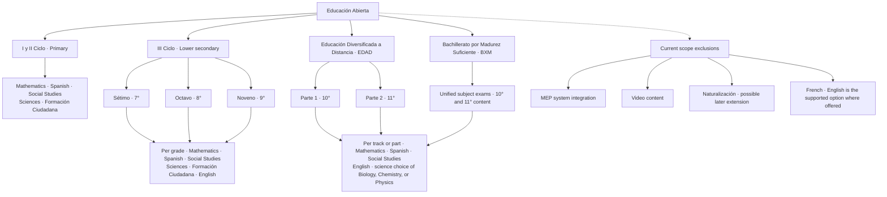
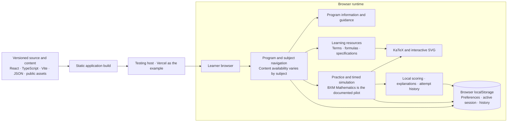
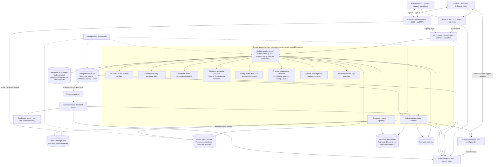
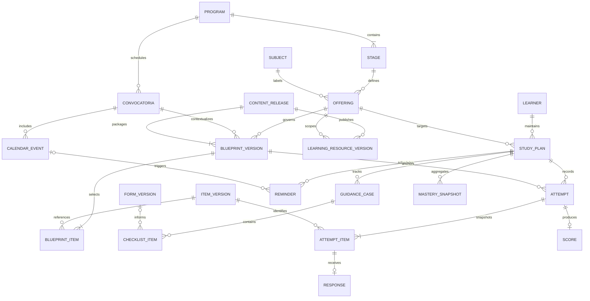
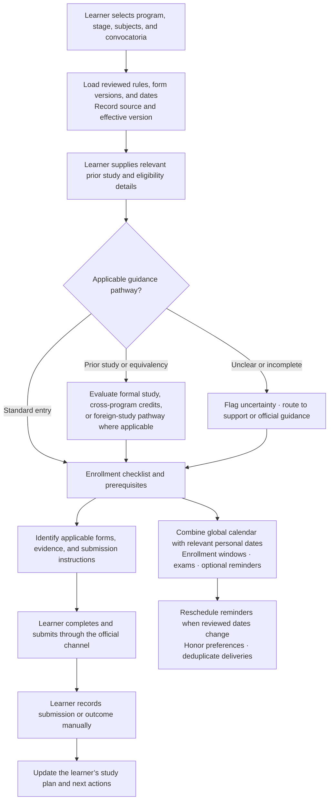
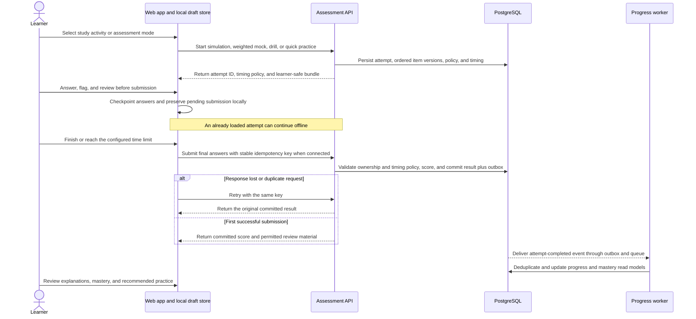
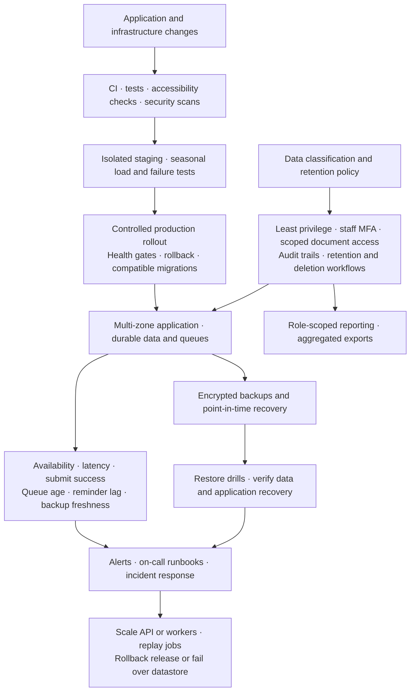

# MEP EA Digital · System design blueprint

The platform supports Costa Rica’s Educación Abierta learners from program selection and enrollment preparation through study, practice, and progress review. The production diagrams describe a proposed architecture. Program coverage defines the target curriculum scope. Each program, level, subject, and convocatoria requires approved content before it becomes available to learners.

The [source SVG](../Project-Solutions-Development.svg) defines the product scope. The [repository README](../README.md) and the [infrastructure](01_SYSTEM_AND_INFRASTRUCTURE_ARCHITECTURE.md), [domain](02_CORE_SERVICES_AND_DOMAIN_MODEL.md), [content](03_CONTENT_PIPELINE_AND_LEGAL_DECOUPLING.md), and [guidance](07_ENROLLMENT_AND_PRIOR_RECOGNITION_ENGINE.md) specifications provide implementation context. Each Mermaid block is a standalone view of the same system.

## 1. Academic scope and boundaries

## 2. Proof of concept

## 3. Proposed production architecture

Deploy one modular API initially, with workers scaled separately. The component boxes represent domain responsibilities within that API. Keep production and test environments isolated. Cache only public responses at the CDN and serve authenticated content through authorized requests or short-lived scoped URLs. Treat the database as the source of truth for attempts, guidance state, and publication records.

## 4. Academic and learner data model

An offering identifies a subject in a particular stage. A stage can be an entire track, a grade, or an EDAD part. Version source references, prerequisite and recognition rules, forms, calendar dates, assessment policies, and content. Preserve the item versions and ordering selected for each attempt so scores and reviews remain reproducible after later releases.

## 5. Enrollment, forms, calendar, and recognition

MEP remains the authority for enrollment and recognition decisions. The platform provides sourced guidance and tracks learner-reported status. The blueprint assumes official form submission and handling of sensitive evidence remain in the official channel.

## 6. Assessment, offline recovery, and progress

Keep answer keys on the server until review is authorized. Enforce one final score per attempt, and reject reuse of a submission key with a different payload. Before launch, define how each mode handles a timed attempt whose submission reaches the server after an offline period. Until the server accepts it, show the result as pending.

## 7. Content governance and release

```mermaid
flowchart LR
    SRC["Published MEP or DGEC materials<br/>Specifications · schedules · forms · reference exams"]
    SRC --> IN["Staff capture · provenance · usage rights · effective dates"]
    IN --> DRAFT["Author independent lessons, items, explanations,<br/>formula sheets, SVG visuals, and blueprints"]
    DRAFT --> VALIDATE["Automated checks<br/>Schemas · references · blueprint coverage · item scoring"]
    VALIDATE --> REVIEW["Human review<br/>Academic accuracy · accessibility · rights · source alignment"]
    REVIEW -->|Changes needed| DRAFT
    REVIEW -->|Approved| STAGE["Stage immutable release<br/>Validate learner routes and catalog availability"]
    STAGE --> PUBLISH["Promote release pointer atomically"]
    PUBLISH --> CATALOG["Serve approved program, stage, subject, and convocatoria"]
    PUBLISH --> HISTORY["Audit release, approvals, and source versions"]
    HISTORY -->|Recovery| ROLLBACK["Repoint to prior approved release"]
    ROLLBACK --> CATALOG
    CATALOG --> PIN["Existing attempts keep their pinned versions"]
```

## 8. Operations, security, and recovery

Use the repository’s planning envelope of 5,000 concurrent users and 1,500–2,500 peak requests per second as a load-test hypothesis. Exercise convocatoria traffic with a cold cache, bursts of final submissions, worker backlogs, and database failover. Set service-level objectives and recovery targets after measuring demand and confirming operational constraints. Provider, region, runtime sizing, retention periods, and recovery objectives remain design decisions. The production topology assumes managed infrastructure with multi-zone availability and independent scaling for public delivery, API traffic, and background work.
