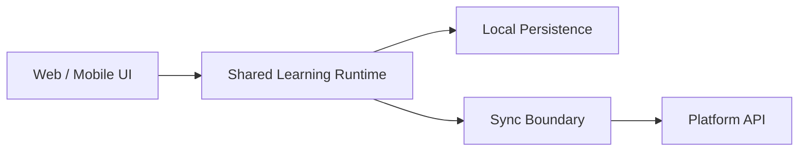

# P0 — Production Platform Foundation Plan

Implementation and verification: [P0 execution report](P0_EXECUTION.md), 2026-11-08, branch `p0milestone`. The implementation is in place; native device smoke validation remains pending. The original plan and acceptance gates below remain the milestone baseline.

The goal should be to take the POC codebase and establish the production-oriented application foundation implied by the new architecture, without yet building the full product.
P0 — Production Platform Foundation
Objective: establish the technical skeleton that allows Web + iOS + Android to evolve from the POC without creating another architectural dead end.
1. Establish the monorepo / package boundaries
Create the intended separation between platform-specific applications and shared product logic:
apps/
├── web/                  # React web application
└── mobile/               # Expo / React Native

packages/
├── domain/               # Core business/domain logic
├── content/              # Content schemas + runtime
├── api/                  # API contracts/client
├── validation/           # Shared validation
├── analytics/            # Telemetry contracts
├── design-system/        # Shared design tokens
└── learning-runtime/     # Assessment/progress state

P0 outcome: future development has an explicit place to go.

Don't try to extract every existing component immediately. Establish the boundaries first and migrate deliberately.
2. Define the shared domain contracts
This is probably the highest-value P0 implementation.

Turn the architectural concepts into stable TypeScript contracts:
Program
Subject
CurriculumDomain
Concept
Question
QuestionOption
Assessment
AssessmentBlueprint
Attempt
Answer
Score
Diagnostic
RemediationPlan
LearningProgress
GuidanceEvaluation

The important distinction is:
The UI should consume domain models; the domain models should not be designed around today's UI.

For example:
Question
   │
   ├── Web renderer
   └── Mobile renderer

rather than:
WebQuestionComponent
   └── copied/reimplemented
       MobileQuestionComponent

3. Establish the content contract
Your content architecture is unusually important because MEP EA isn't simply a CRUD application.

The target pipeline is roughly:
Official / authored source
        ↓
Content ingestion
        ↓
Curriculum taxonomy
        ↓
Concept / item registry
        ↓
Blueprint
        ↓
Assessment runtime
        ↓
Scoring
        ↓
Diagnosis
        ↓
Remediation

P0 should therefore establish the canonical schemas and validation around this pipeline.

At minimum:
Question schema
Concept schema
Curriculum taxonomy
Assessment blueprint schema
Program metadata
Visual specification schema

Then make the existing content conform to those contracts where practical, rather than designing new screens around the existing ad-hoc content structures.
4. Build the shared assessment runtime
This should be the first real domain engine.

Not a complete exam product yet.

Build the platform-independent runtime responsible for:
Load assessment
      ↓
Initialize attempt
      ↓
Present item
      ↓
Record answer
      ↓
Navigate
      ↓
Persist state
      ↓
Submit
      ↓
Score
      ↓
Return result

The runtime should be usable by both:
Web
 ↓
Assessment Runtime

Mobile
 ↓
Assessment Runtime

This is where you begin converting the existing POC's useful assessment behavior into actual product architecture.
5. Implement local-first persistence
Because the architecture explicitly anticipates offline/local operation, I would make this part of P0 rather than leaving it until after mobile development.

The basic architecture:

For P0, the important thing is not necessarily implementing the complete cloud synchronization system.

Instead establish the abstraction:
PersistenceAdapter
        │
        ├── LocalAdapter
        └── RemoteSyncAdapter

That prevents the assessment engine from becoming coupled to localStorage, IndexedDB, React state, or a future backend.
6. Establish authentication boundary
Don't build the entire account system yet.

Establish the contract:
Client
  ↓
Auth abstraction
  ↓
Authenticated session
  ↓
API client

with clear separation between:
- anonymous/free user
- authenticated learner
- premium learner
- content/admin role
The architecture should allow authentication to change later without rewriting the domain/application layer.
7. Create the mobile foundation
At this point I would create the Expo application, but I would not immediately port the entire web application.

The first mobile milestone should prove:
Expo app
   ↓
Shared packages
   ↓
Shared domain
   ↓
Shared content
   ↓
Shared assessment runtime
   ↓
Local persistence

A simple diagnostic/assessment screen is enough to prove the architecture.

The objective is architectural validation, not feature completeness.
8. Keep the POC running during migration
This is important.

Don't turn P0 into a giant rewrite.

Use the existing application as the reference/validation environment while extracting production foundations:
                 P0
                  │
       ┌──────────┴──────────┐
       │                     │
 Existing POC          New Architecture
       │                     │
 visual reference       shared contracts
 functional reference  domain runtime
                       mobile foundation
                       persistence

Then progressively move capabilities from the POC into the new architecture.
P0 acceptance gates
I would make the milestone pass/fail, not a vague "architecture setup" milestone.
Gate 1 — Repository
[x] Web application isolated
[x] Mobile/Expo application exists
[x] Shared package boundaries established
[x] Build/test tooling works across packages

Gate 2 — Domain
[x] Canonical domain types exist
[x] No platform UI dependency in domain layer
[x] Assessment lifecycle represented
[x] Program/content concepts represented

Gate 3 — Content
[x] Canonical content schemas exist
[x] Existing representative content can be loaded
[x] Blueprint can resolve to questions
[x] Schema validation works

Gate 4 — Assessment
[x] Assessment can initialize
[x] Questions can be answered
[x] State persists locally
[x] Assessment can resume
[x] Assessment can submit
[x] Scoring is deterministic

Gate 5 — Cross-platform
[x] Same assessment/domain package runs on Web
[ ] Same assessment/domain package runs on Expo — both native bundles pass; device smoke still pending
[x] Platform-specific UI remains thin

Gate 6 — Architecture integrity
[x] No new dependency from domain → React
[x] No new dependency from domain → Expo
[x] Content is not hardcoded into UI components
[x] Assessment logic is not duplicated per platform
[x] POC-specific architecture is not silently promoted to target architecture

What I would explicitly not do in P0
This is just as important.

Don't make the first milestone:
- full mobile app
- App Store / Play Store release
- complete backend
- payment integration
- complete authentication UX
- migration of every existing screen
- complete analytics dashboard
- complete notification system
- production cloud deployment
- redesign of every POC page
Those are downstream milestones.

The first objective is to establish the load-bearing architecture.
The resulting development sequence
I would therefore structure the next phase approximately as:
P0  Production Platform Foundation
 │
 ├── Monorepo / package boundaries
 ├── Shared domain contracts
 ├── Content contracts
 ├── Assessment runtime
 ├── Local-first persistence
 ├── Auth/API boundaries
 └── Expo mobile foundation
          │
          ▼
P1  Core Product Vertical Slice
 │
 ├── Program selection
 ├── Assessment
 ├── Scoring
 ├── Diagnostic
 ├── Remediation
 └── Web + Mobile end-to-end flow
          │
          ▼
P2  Content & Learning Expansion
          │
          ▼
P3  Production Backend / Accounts / Sync
          │
          ▼
P4  Guidance + Analytics + Premium
          │
          ▼
P5  Release Hardening

The key is that P0 should produce something executable, not another architecture document. By the end of it, you should have the beginnings of the real platform—Web and Expo clients consuming the same domain/content/assessment foundation—while the existing POC remains available as a reference and migration target.
